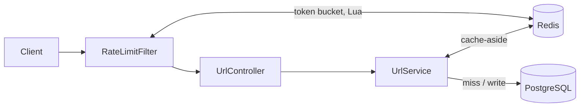

# URL Shortener

Spring Boot + PostgreSQL + Redis. Small in scope, but it touches the things system-design interviews dig into: ID generation, read-heavy caching, rate limiting, and graceful degradation.

## Run it

```bash
docker compose up -d          # Postgres 16 + Redis 7
mvn spring-boot:run           # needs JDK 21; schema is created on startup
```

```bash
# create a link (optionally expiring in N days)
curl -i -X POST localhost:8080/api/shorten \
  -H 'Content-Type: application/json' \
  -d '{"url":"https://example.com/a/very/long/path?x=1","ttlDays":30}'

# follow it (302)
curl -i localhost:8080/100000

# stats
curl localhost:8080/api/stats/100000

# see the rate limiter kick in (burst of 10, then 429 with Retry-After)
for i in $(seq 1 15); do curl -s -o /dev/null -w "%{http_code}\n" -X POST localhost:8080/api/shorten \
  -H 'Content-Type: application/json' -d '{"url":"https://example.com"}'; done
```

Tests: `mvn test` (Base62 round-trips; service tests for cache hit, miss, negative caching, expiry, Redis outage, URL validation).

## Architecture



**Write (`POST /api/shorten`)**: validate URL → `nextval` from a Postgres sequence → Base62-encode it → insert row → write-through to Redis → return code.

**Read (`GET /{code}`)**: format check → Redis → (miss) Postgres → populate Redis → `302`. Click count is a Redis `INCR`.

## Design decisions (the interview talking points)

### 1. Generating the short code
| Approach | Pros | Cons |
|---|---|---|
| **Sequence id → Base62** (used here) | No collisions by construction, no retry loop, shortest codes | Sequential, so codes are guessable/enumerable; sequence is a single write point |
| Random code + unique constraint | Not guessable | Collision retries grow as the table fills |
| Hash of URL (MD5/SHA, truncated) | Same URL gives same code | Truncation collisions; needs a retry strategy |

Capacity: 6 chars of Base62 is ~56.8 billion codes, 7 chars is ~3.5 trillion. The sequence starts at 62^5 so codes begin at 6 chars. `CACHE 50` on the sequence means each instance reserves ids in blocks.

*Scaling the write path*: one Postgres sequence is fine into the thousands of writes/sec. Beyond that, give each app instance a range (the Hi/Lo or "ticket server" pattern) or shard by id range.
*Fixing enumerability*: pass the id through a reversible scramble (e.g. a multiplicative permutation mod 2^k) before encoding. Still collision-free, no longer sequential.

### 2. Caching (cache-aside)
Traffic is overwhelmingly reads (think 100:1), and a link almost never changes, so this is the ideal caching shape.
- **Write-through on create** so the first click is already a hit.
- **TTL = min(configured, time until expiry)**, so the cache never serves a dead link.
- **Negative caching**: a "missing" marker (short TTL) stops repeated requests for non-existent codes from hammering Postgres.
- **Code format check before any lookup** keeps garbage out of the cache keyspace.
- **Redis `allkeys-lru`** with a memory cap: it's a cache, so evicting cold entries is the desired behaviour.
- **Known gap, cache stampede**: when a hot key expires, many requests can hit Postgres at once. Fixes: per-key single-flight/locking, jittered TTLs, or refresh-ahead.

### 3. Rate limiting (distributed token bucket)
- Algorithm choice: **token bucket** allows a legitimate burst but caps the sustained rate. Fixed-window counters allow 2x bursts at window edges; sliding-window logs cost memory per request.
- Implemented as a **Lua script**, so read → refill → decide → write is atomic across all app instances. A naive GET-then-SET would race.
- The **clock comes from Redis `TIME`**, so skewed app-server clocks can't mint extra tokens.
- Buckets expire when idle (2x full-refill time), so Redis doesn't accumulate dead keys.
- Two policies: creating links is strict (10 burst, 0.5/s), following links is lenient (100 burst, 50/s). Responses carry `Retry-After` and `X-RateLimit-Remaining`.
- **Fails open**: if Redis is down, requests pass. Availability of redirects beats perfect throttling; the opposite choice is defensible for an abuse-sensitive API, so say which and why.
- Keyed by client IP. Behind a load balancer you must configure trusted `X-Forwarded-For` handling, otherwise everyone shares the LB's address, or clients can spoof the header.

### 4. Failure modes
| Failure | Behaviour |
|---|---|
| Redis down/slow | 200 ms timeouts; reads fall back to Postgres, rate limiter fails open, clicks not counted |
| Postgres down | Cache hits still redirect; misses and creates fail |
| Cache and DB disagree | Only on expiry edge cases; TTL is capped at expiry |

### 5. HTTP details
- **302, not 301.** A 301 is cached by browsers essentially forever, which hides clicks from analytics and makes expiry/deletion unenforceable. The cost is that every click reaches the service.
- Only `http`/`https` URLs, with a host and no embedded credentials (blocks `javascript:`, `ftp:`, `user:pass@host` tricks).

## Back-of-envelope numbers
Assume 100M new links/month and a 100:1 read/write ratio.
- Writes: 100M / (30 × 86,400 s) ≈ **40/s**. Reads: ≈ **4,000/s** average, perhaps 10× at peak.
- Storage: ~500 B/row × 100M × 12 × 5 years ≈ **3 TB**. Fits one Postgres primary; shard by id range if it grows.
- Cache: links follow a power law, so caching the hottest ~20% typically absorbs most reads. Even 10M entries × ~200 B ≈ 2 GB.

## Known limitations / what I'd do next
- **Click counts live only in Redis.** A flush or eviction loses them. Next step: write-behind to Postgres, or emit click events to a queue (Kafka) and aggregate asynchronously.
- No deduplication: the same URL submitted twice gets two codes.
- No custom aliases, no deletion API, no auth or per-user quotas.
- Schema is created by `schema.sql`; use Flyway/Liquibase for real migrations.
- No read replicas, and one Redis node. Production would add Redis replicas/Cluster and Postgres read replicas, with the redirect path reading from replicas.
- Abuse: no malware/phishing URL screening. A real shortener needs it.
- Add integration tests with Testcontainers (Postgres + Redis) and metrics for cache hit ratio and 429 rate.

## Layout
```
config/       typed configuration (ShortenerProperties)
domain/       Base62, UrlMapping
repository/   UrlRepository (JdbcClient, sequence + lookups)
service/      UrlService (validation, cache-aside, click counting)
ratelimit/    RedisRateLimiter + RateLimitFilter; scripts/token_bucket.lua
web/          controller, DTOs, error handling
```

> **Note:** Postgres is exposed on host port **5433** (not 5432) to avoid clashing with a locally installed Postgres. The app's default DB URL matches this.

> **Note:** Postgres is exposed on host port **5433** (not 5432) to avoid clashing with a locally installed Postgres. The app's default DB URL matches this.
